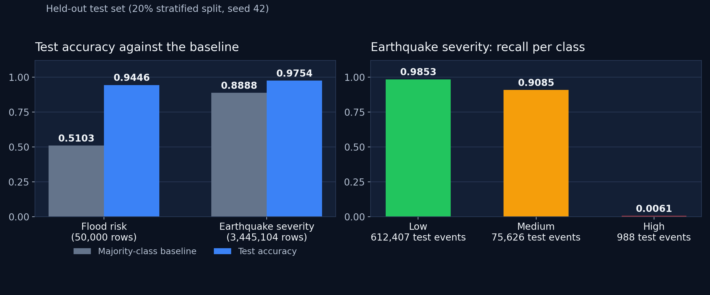
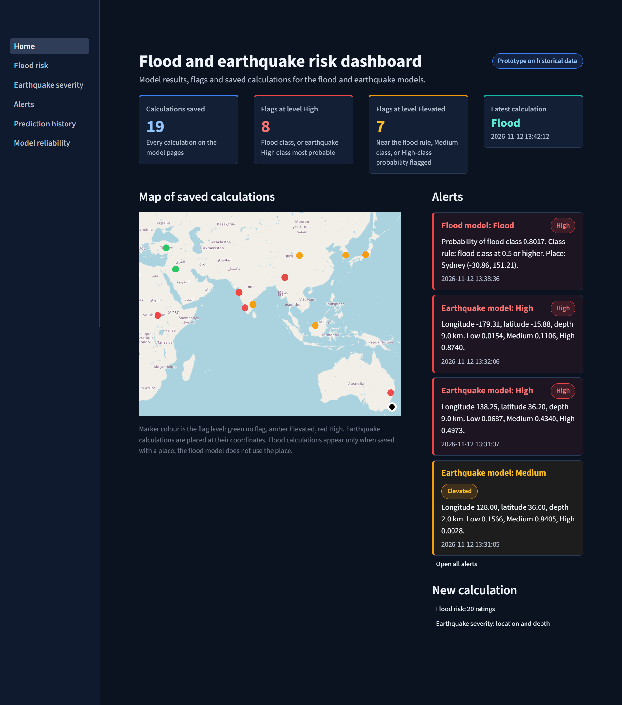
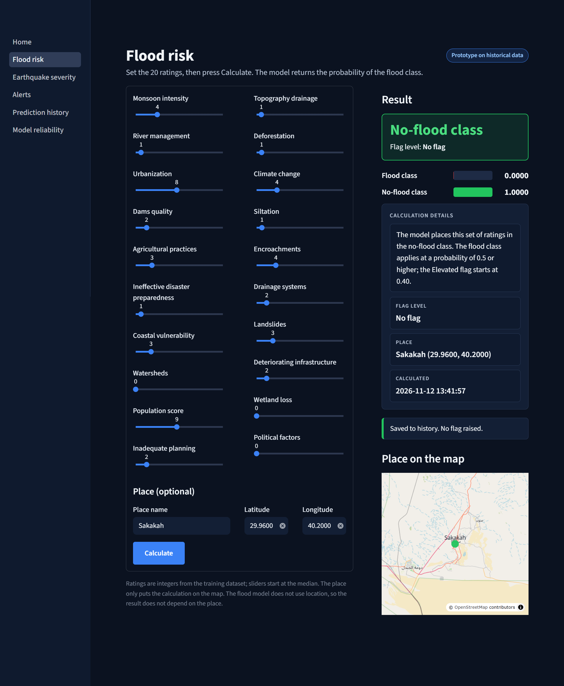
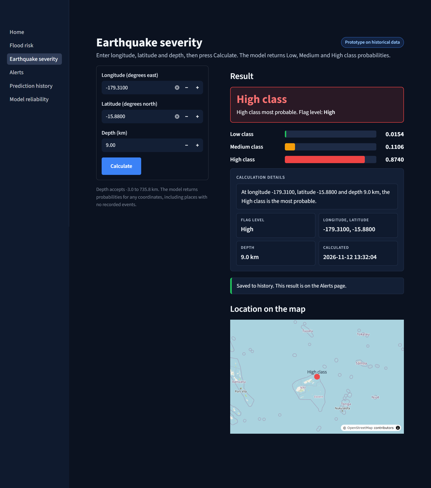
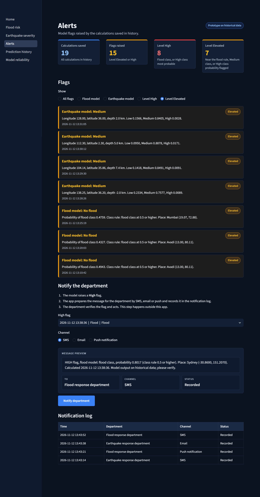
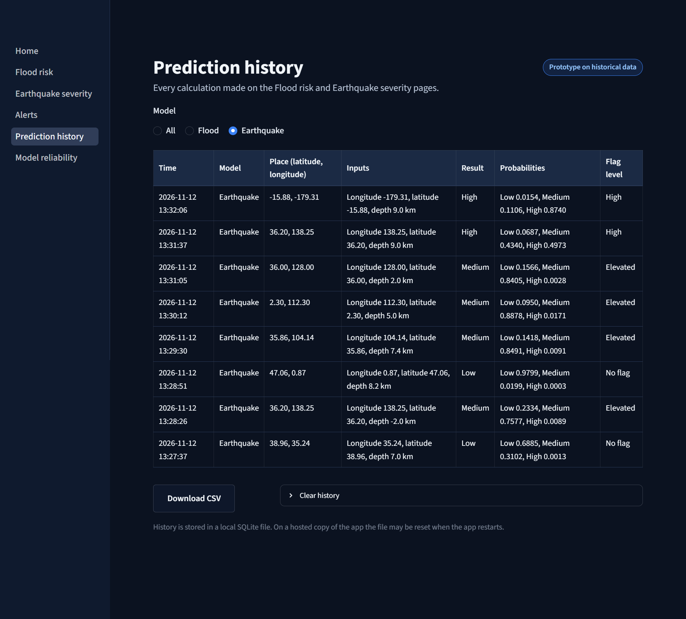
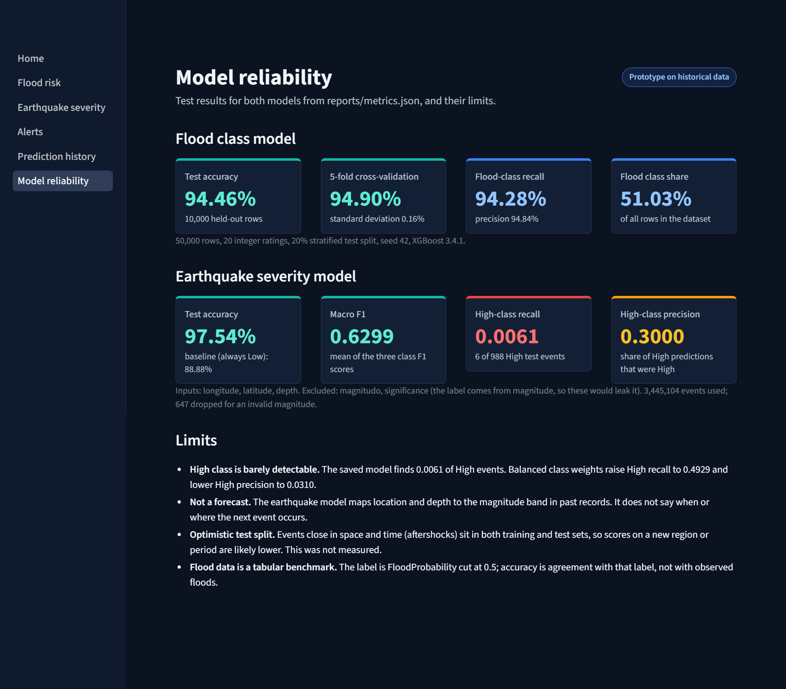

# Flood and Earthquake Risk Prediction

Live prototype:  https://disaster-risk-prediction-earthquake-flood.streamlit.app

Notes on the hosted copy:

- Saved calculations and alerts belong to your browser session only. Other visitors cannot see them, and a session's history is deleted after 24 hours without use.
- The app goes to sleep after 12 hours without visitors. The first visit after that shows a wake-up page; click the button and wait for it to start.
- Times shown on the hosted copy are server time (UTC).


Two XGBoost classifiers, K-means clustering and a Streamlit dashboard, built on public historical datasets.
This is a prototype. It is not a forecasting or early-warning system.

## What is in the repository

- **Flood model.** XGBoost classifier. Input: 20 integer ratings. Output: probability of the flood class (`FloodProbability >= 0.5`).
- **Earthquake severity model.** XGBoost classifier. Input: longitude, latitude, depth. Output: probabilities of the
  Low (magnitude below 4.0), Medium (4.0 to below 6.0) and High (6.0 or higher) classes. Magnitude and significance are excluded
  because they would leak the label.
- **K-means clustering** of earthquake events and flood ratings, with inertia and silhouette for K = 2 to 7.
- **Dashboard.** A Streamlit app with six pages: Home (counts, a map of saved calculations, the latest flags), Flood risk, Earthquake severity,
  Alerts, Prediction history and Model reliability. Each calculation shows class probabilities and a flag level. Calculate does not save; a
  separate Save to history button does. The earthquake form requires longitude and latitude and accepts depths from -3.0 to 735.8 km.
  Maps use OpenStreetMap tiles, which need an internet connection.
- **Baseline notebooks.** Random Forest comparison models and a notebook that reproduces the XGBoost results.

## Results (reference run, XGBoost 3.4.1, seed 42, 20% stratified test split)

| Model | Test accuracy | Other |
|---|---|---|
| Flood class | 94.46% | 5-fold cross-validation 94.90% (standard deviation 0.16%) |
| Earthquake severity | 97.54% | Majority-class baseline 88.88%. Macro F1 0.6299. High-class recall 0.0061 (6 of 988) |



The figure is drawn from `reports/metrics.json` by `visualisation/make_results_figure.py`. On the earthquake model, accuracy is above the baseline
because most events are Low; the right panel shows that the High class is almost never found.

Read these with their limits:

- Flood accuracy is agreement with the dataset's own label. The dataset is a tabular benchmark, not field measurements.
- The earthquake model finds 6 of the 988 High events in the test set (recall 0.0061; precision 0.30). Location and depth do not separate High from Medium events.
  It maps a location to the magnitude band seen in past records; it does not predict when or where an earthquake occurs.
- A random test split puts aftershocks in both training and test sets, so scores on a new region or period are likely lower. This was not measured.

## Screenshots

Home page: counts of saved calculations and flags, a map of the saved calculations and the latest alerts.



Flood risk page: 20 ratings, the flood class probability and the flag level.



Earthquake severity page: longitude, latitude and depth, the Low, Medium and High class probabilities and the location on the map.



Alerts page filtered to Elevated flags, with the message preview for a High flag and the notification log.



Prediction history page filtered to the Earthquake model: saved calculations, with a CSV download.



Model reliability page: test results from `reports/metrics.json` and the limits.



## Layout

```
datasets/            raw/ (downloaded by you), samples/ (generated),
                     make_samples.py, README.md (sources and licences)
src/disaster_risk/   config, data loading, training, prediction,
                     alert rules, SQLite history
visualisation/       make_clusters.py (K-means), make_figures.py
                     (exploratory figures), make_results_figure.py
                     (results chart), maps.py, theme.py
dashboard/           Home.py, ui.py, pages/ (Streamlit app)
models/              flood_xgb.json, earthquake_severity_xgb.json,
                     flood_features.json
notebooks/           XGBoost_Disaster_Prediction.ipynb,
                     Disaster_Prediction_ML_Pipeline.ipynb
                     (Random Forest baselines)
reports/             metrics.json, figures/ (cluster, exploratory and
                     results figures, cluster_info.json)
tests/               pytest tests
docs/                reference_results.md, screenshots/
run.bat, run.sh      start the dashboard (creates .venv and installs
                     on the first run)
```

## Quick start

Python 3.11 or newer and an internet connection (package download, map tiles).

- Windows: double-click `run.bat`, or run `run.bat` in a terminal opened in the repository folder.
- macOS or Linux: `sh run.sh`

The first run creates `.venv`, installs `requirements.txt` (several minutes) and starts the dashboard in the browser. Later runs skip the
install and start directly. If Streamlit asks for an email address on the first launch, press Enter.

Manual setup, if you prefer: `pip install -r requirements.txt`, then `streamlit run dashboard/Home.py`. Started this way, each browser
session gets its own private history (see History storage); set the environment variable `DISASTER_HISTORY_MODE=local` to keep one
history file between runs, as `run.bat` and `run.sh` do. For the training commands below, also run `pip install -e .`.

To see a High earthquake flag, open Earthquake severity and enter longitude -179.306, latitude -15.879, depth 9.0 km, then press Calculate
and Save to history. This point is taken from the training sample; the High-class probability there is 0.874.

## Run

Run every command from the repository root.

1. Download the three CSV files listed in `datasets/README.md` into `datasets/raw/`.
2. `python -m disaster_risk.train_flood` trains the flood model and writes `models/flood_xgb.json`, `models/flood_features.json` and the flood part of `reports/metrics.json`.
3. `python -m disaster_risk.train_earthquake` trains the earthquake model (several minutes on 3.4 million rows) and writes its part of `reports/metrics.json`.
   `python -m disaster_risk.train_earthquake --variant balanced` adds the balanced-weight comparison to the metrics; it saves no model.
4. `python datasets/make_samples.py` builds the sample files; the dashboard reads the depth range from `samples_info.json`.
5. `python visualisation/make_clusters.py` writes the K-means figures and `reports/figures/cluster_info.json`.
   `python visualisation/make_figures.py` writes the exploratory figures.
   `python visualisation/make_results_figure.py` writes `reports/figures/model_results.png` from `reports/metrics.json`.
6. `streamlit run dashboard/Home.py`
7. `pytest` runs the tests in `tests/` (flag rules, history, notifications, predictions, every dashboard page).

The trained models, `reports/` and `datasets/samples/` are committed, so the dashboard runs without steps 2 to 5.
Compare the step 2 and 3 output with `docs/reference_results.md`.

## Alerts

Every calculation gets a flag level. Saving a calculation that is Elevated or High adds it to the flag list on the Alerts page.

| Model | No flag | Elevated | High |
|---|---|---|---|
| Flood | flood-class probability below 0.40 | 0.40 to below 0.50 | 0.50 or higher (flood class) |
| Earthquake | Low class most probable, High-class probability below 0.05 | Medium class most probable, or Low class most probable with High-class probability of 0.05 or more | High class most probable |

The values 0.40 and 0.05 are display settings in `src/disaster_risk/alerts.py`, not measured results. The 0.50 flood rule and the magnitude
bands come from `src/disaster_risk/config.py`. Flags appear on the Alerts page (a list with a filter) and, for the latest four, on Home.

The Alerts page offers "Notify the department" only for level High. Choose a High flag and a channel (SMS, Email or Push notification),
check the message preview (To, Channel, Status) and press Notify department. The notification is written to a notification log with the
status Recorded. The same flag and channel cannot be recorded twice.

Email, SMS and push delivery are not connected, so nothing is sent; that is why the status is Recorded and not Delivered. The department
names in `alerts.py` are placeholders. Verification by the department happens outside this app, and the app has no verify button.

With the current earthquake model, High is the most probable class for 20 of the 689,021 test rows, so an earthquake High flag is rare;
Elevated flags are much more common.

## History storage

Saved calculations and notification records are stored in SQLite files under `storage/` (ignored by git).

- `run.bat` and `run.sh` set `DISASTER_HISTORY_MODE=local`: one file, `storage/history.sqlite`, kept between runs.
- Any other start, for example a hosted copy of the app, gives each browser session its own file in `storage/sessions/`. A visitor can see and
  change only their own history and notification log. A new session starts empty, and a session file is deleted after 24 hours without use.
- `DISASTER_HISTORY_DB=<path>` forces one explicit file (the tests use it).

## Licence

Code: MIT, Copyright (c) 2026 A Nivetha (see `LICENSE`). Datasets: CC0 1.0, from Kaggle (see `datasets/README.md`).
